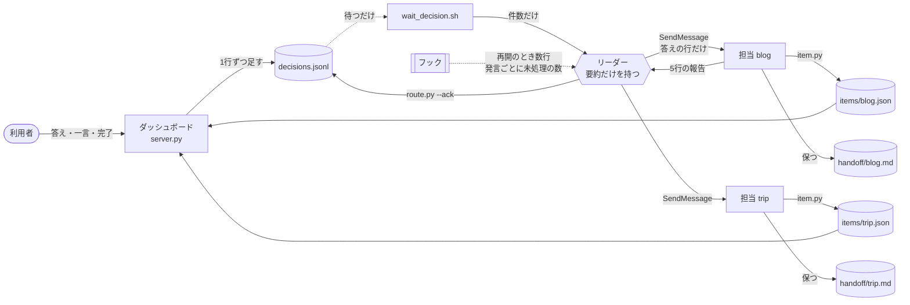

# claude-leader-dashboard

「今日のリーダー」を Claude Code に任せるプラグイン。

Claude がその日のタスクを洗い出し、プロジェクトごとに担当のエージェントを出して下書きまで作る。判断が要ることだけを、手元のブラウザーで開くダッシュボードに並べる。利用者はプロジェクトを開き、1件ずつ選択肢とメモで答える。答えは Claude に届き、Claude は動いた結果を同じ画面に返す。

- チャットには URL と件数だけが出る。判断の材料・下書き・図はダッシュボードで読む
- 画面は macOS の標準アプリの形で、左にサイドバー（全体・プロジェクト・今日の予定）、真ん中に一覧（Mail の形）、右に1件。色はシステムに従い、ライトとダークは Mac の設定のまま。ページ全体はスクロールしない
- `j` / `k`（または `↑` / `↓`）で項目、`←` / `→` か `⌘1`〜 でサイドバーを移る。`x` か「完了にする」で項目を済みにする（知らせから元に戻せる）。1件の問いに全部答えると、次の判断待ちへ進む
- 済んだ項目は一覧の下の「済み（N）」に畳まれる
- Claude が項目を変えると、Mail の未読のようにアクセントの色の点が付く。開くと既読になる。Claude の最新の動きはツールバーに出て、新しく来ると右下に知らせが出る
- ツールバーの欄から、どこからでも Claude に一言送れる
- 下書きは元のファイルから毎回読む。コピーのボタンと「開く」のリンクが付く
- 全体を開くと、判断待ちの数・プロジェクトごとの判断待ちと済み・Claude の動きが右に出る
- 図は Claude が書いた SVG をそのまま描く
- 一日続けても、リーダー（Claude の会話）が膨らまない。資料・下書き・やり取りは担当のエージェントと画面とメモが持ち、リーダーは要約だけを持つ（「コンテキストを抑える仕組み」）
- 依存は Python 3.9 以上の標準ライブラリと bash だけ。サーバーは 127.0.0.1 だけで受ける

## 入れ方

Claude Code で次を実行する。

```
/plugin marketplace add kumachan99/claude-leader-dashboard
/plugin install leader-dashboard@claude-leader-dashboard
```

手元に clone したものから入れるときは、1行目を `/plugin marketplace add /path/to/claude-leader-dashboard` にする。

## 使い方

Claude Code に、たとえば次のように頼む。

> 今日のリーダーはあなた。プロジェクトごとに担当を出して下書きまで作って。判断はダッシュボードで受けて。

スキル `leader` が読み込まれる（`/leader-dashboard:leader` でも呼べる）。

1. Claude がタスクを洗い出し、プロジェクトごとに担当のエージェントを出す
2. Claude がチャットに書いた URL（既定は `http://127.0.0.1:8765/`）を開く
3. サイドバーでプロジェクトを選び、一覧から1件ずつ開いて答える。項目に無いことは、ツールバーの「Claude に一言」で頼める
4. Claude の返事は、問いの下と、ツールバーと、全体の「Claude の動き」に出る。画面は4秒ごとに新しくなる

送信・投稿・予約・購入・削除のように外に出る操作は、利用者がその項目に答えてから行う決まりにしてある（スキルの「守ること」）。

## コンテキストを抑える仕組み

一日リーダーを続けると、各エージェントの長い報告・下書きの本文・やり取りが、リーダーの会話にたまっていく。このプラグインは、それを裏側で分ける。



| 仕組み | 置き場 | 役目 |
| --- | --- | --- |
| プロジェクトの担当 | `agents/project-lead.md` | 1つのプロジェクトを一日受け持つエージェント。資料を読み、下書きを作り、画面の自分の項目を書き換え、引き継ぎのメモを保つ。リーダーへの報告は5行以内。外に出る操作はしない |
| 項目をプロジェクトごとに | `items/<project>.json`・`item.py` | 担当は自分のファイルだけを `item.py` で書く（JSON を手で壊さない）。サーバーは `items.json` と合わせて返す |
| 引き継ぎのメモ | `handoff/<project>.md`・`handoff/_leader.md` | 現在地・判断待ち・触ったファイル・次の一手。再開するとき（圧縮の後、翌日）はこれだけ読む |
| 答えの振り分け | `route.py`・`cursor`・`roster.json` | `wait_decision.sh` は待つだけ。`route.py` が振り分けていない答えをプロジェクトごとに短くまとめ、担当の ID を添える。リーダーはそれを SendMessage で回すだけ |
| フック | `hooks/hooks.json` | 会話の始め（起動・再開・`/clear`・圧縮の後）に、URL・判断待ちの数・未処理の答えの数・メモの場所を数行で出す。利用者の発言ごとに、未処理の答えがあれば1行だけ出す |

リーダーの決まり（下書きの本文を自分で読まない、プロジェクトが2つ以上なら担当を出す、など）は [SKILL.md](plugins/leader-dashboard/skills/leader/SKILL.md) の「コンテキストの決まり」にある。

作業フォルダーは `<カレントディレクトリ>/.leader/<今日の日付>`。別の場所に置くときは、環境変数 `LEADER_DASHBOARD_DIR` で指す（フックも同じ順で探す）。

## Claude なしで画面を試す

例の `items.json`（架空の私生活の例）で起動できる。

```
cd plugins/leader-dashboard/skills/leader/examples
cp -r demo /tmp/leader-demo
python3 -I ../scripts/server.py --dir /tmp/leader-demo --root . --port 8799
```

`http://127.0.0.1:8799/` を開く。別の端末で次を動かすと、Claude 側の動きを手で試せる。

```
cd plugins/leader-dashboard/skills/leader/examples
bash ../scripts/wait_decision.sh /tmp/leader-demo 0    # 画面で答えを送ると、20 秒後に終わる
python3 -I ../scripts/reply.py /tmp/leader-demo --qid trip-inn-pick --text "宿 A で進める"
python3 -I ../scripts/reply.py /tmp/leader-demo --status trip-inn done --log "宿 A に決めた"
```

プロジェクトごとのファイルに分けた例（`examples/projects/`）では、担当の動きと振り分けを試せる。

```
cd plugins/leader-dashboard/skills/leader/examples
cp -r projects /tmp/leader-projects
python3 -I ../scripts/server.py --dir /tmp/leader-projects --root . --port 8799
# 別の端末で
python3 -I ../scripts/item.py /tmp/leader-projects lead blog working "告知の文を直している"
python3 -I ../scripts/item.py /tmp/leader-projects ask blog blog-next blog-next-topic "どれにする？" --option "家庭菜園" --option "ノート PC の再生"
bash ../scripts/wait_decision.sh /tmp/leader-projects cursor    # 答えを送ると、20 秒後に件数だけ出して終わる
python3 -I ../scripts/route.py /tmp/leader-projects --ack       # プロジェクトごとにまとめて出し、振り分け済みにする
```

## 作業フォルダー

サーバーは `--dir` で渡したフォルダーを読み書きする（既定は `LEADER_DASHBOARD_DIR` か `.leader/<今日の日付>`）。

| ファイル | 書くのは | 中身 |
| --- | --- | --- |
| `items.json` | リーダー | 題・見出し・予定・タブの並び。担当のいない項目。サーバーは要求のたびに読み直す |
| `items/<project>.json` | 担当（`item.py`） | プロジェクトごとの項目と担当の状態 |
| `drafts/` | 担当 | 下書き |
| `handoff/` | 担当・リーダー | 引き継ぎのメモ |
| `roster.json` | `route.py --roster` | 担当の名簿（プロジェクト → エージェントの ID） |
| `leader.json` | `reply.py` | Claude の返事・項目の状態・動いたこと |
| `decisions.jsonl` | サーバー | 利用者の答え・一言・完了ボタンの操作。1行に1件 |
| `cursor` | `route.py --ack` | 振り分け済みの行数 |
| `server.json` | サーバー | 起動中の URL・pid。止まると消える |

下書きや判断に私的な情報が入るので、作業フォルダーは git に入れない。リポジトリの中で使うなら、`.gitignore` か `.git/info/exclude` に `.leader/` を足す。

項目の書き方は [SKILL.md](plugins/leader-dashboard/skills/leader/SKILL.md) の「項目の書き方」にある。例は [examples/demo/items.json](plugins/leader-dashboard/skills/leader/examples/demo/items.json) と [examples/projects/](plugins/leader-dashboard/skills/leader/examples/projects/)。

## 中身

```
.claude-plugin/marketplace.json        マーケットプレイスの定義
plugins/leader-dashboard/
  .claude-plugin/plugin.json           プラグインの定義
  agents/project-lead.md               プロジェクトの担当のエージェント
  hooks/hooks.json                     会話の始めと発言ごとのフック
  skills/leader/
    SKILL.md                           Claude 向けの手順
    scripts/server.py                  ダッシュボードのサーバー
    scripts/index.html                 画面
    scripts/wait_decision.sh           答えが届くまで待つ
    scripts/route.py                   答えを担当ごとに振り分ける・担当の名簿
    scripts/item.py                    items/<project>.json を書き換える
    scripts/reply.py                   leader.json に返事・状態・動いたことを書く
    scripts/leader_hook.py             フックの中身
    scripts/leaderlib.py               道具が共有する部品
    examples/demo/items.json           例の項目
    examples/projects/                 プロジェクトごとのファイルに分けた例
    examples/notes/                    例の下書きの元になるファイル
docs/ui-notes.md                       画面に向けたメモ（state の欄・完了ボタン）
```

## 安全のこと

- サーバーは 127.0.0.1 だけで受ける。`Host` と `Origin` を確かめ、よそのページからの書き込みと DNS リバインディングを断る
- 下書きとして読むファイルは `--root` の中だけ、SVG のファイルは作業フォルダーの中だけ
- SVG の `<script>`・`on...` の属性・`javascript:` のリンクは描く前に落とす

## ライセンス

MIT License。

Copyright (c) 2026 Takahito Okuma
